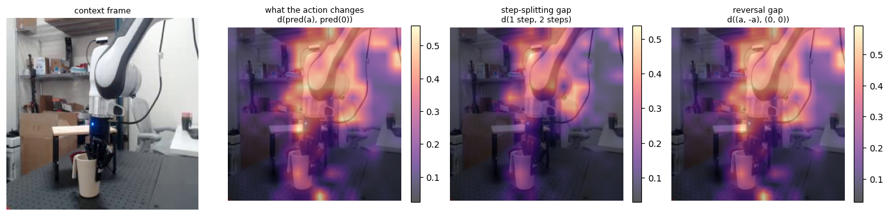

# Consistency audit of V-JEPA 2-AC

A pilot audit of Meta's released V-JEPA 2-AC action-conditioned world model ([facebookresearch/vjepa2](https://github.com/facebookresearch/vjepa2)). It tests whether the frozen predictor respects basic rules of motion for a robot arm, using the example DROID transition shipped in the official repo. No training is involved.

## Tests

| Test | Rule checked |
|---|---|
| 1. Dose-response | A bigger action changes the prediction more, and the best match to the real next frame is at the true action size |
| 2. Step-splitting | Moving by `a` in one step equals moving by `a/K` in `K` steps |
| 3. Path independence | `(a/2, a/2)`, `(a, 0)` and `(0, a)` end in the same latent |
| 4. Reversal | `a` then `-a` equals doing nothing for two steps |
| 5. Direction | The planner's energy points at the true action direction; a training-free controllability weighting is compared with the official uniform cost |
| 6. Action position (3 steps) | The same action placed at step 1, 2 or 3, with and without pose updates |
| 7. Action position (6 steps) | The same action placed at each step of a 6-step rollout |

All distances use the planner's own energy: mean absolute difference between layer-normalised latents.

## Key observations (pilot)

1. **The action at rollout step 2 is almost ignored, and only that step.** Placing the same action at each step of a 6-step rollout changes the final latent by 0.17 to 0.24 at steps 1 and 3 to 6, but by only 0.011 to 0.019 at step 2 (6 to 8% of the step-1 effect). Freezing pose updates does not change this, and steps 3 to 6 also run on imagined frames yet behave normally. This one effect explains the two-step results: d((a,0),(0,a)) / d((a,0),(0,0)) and d((a,-a),(0,0)) / d((a,0),(0,0)) both equal 1.000, and splitting the true action into two steps loses about 64% of its error reduction. Since the official planner optimises two-step action sequences, its second action is effectively not optimised.
   *Hypothesis (untested):* in `app/vjepa_droid/train.py`, step 2 is the only position that also receives the autoregressive rollout loss (`auto_steps: 2` in `configs/train/vitg16/droid-256px-8f.yaml`), so it is trained differently from every other position.
2. Action sensitivity is monotone but saturating: 4x the action gives 1.6x the effect, and the energy basin along the true direction is nearly flat between 1.0x and 1.75x the true magnitude.
3. Over 97 candidate directions of the true magnitude, the minimum-energy direction is 33.7 degrees from the true one (true direction ranked 4th). Controllability weighting raised energy contrast from 2.07σ to 2.27σ without changing the ranking.

### Test 7: the same action placed at each step of a 6-step rollout

| Action placed at | Effect, 5 cm | Effect, 10 cm |
|---|---|---|
| Step 1 | 0.180 | 0.242 |
| **Step 2** | **0.011** | **0.019** |
| Step 3 | 0.180 | 0.240 |
| Step 4 | 0.179 | 0.235 |
| Step 5 | 0.175 | 0.228 |
| Step 6 | 0.171 | 0.217 |

Effect = distance between the final predicted latent and the all-zero-action rollout.



## Repository layout

```
vjepa2_ac_consistency_audit.ipynb   executed notebook with all outputs
results/audit_results.json          every number reported, tests 1 to 7
figures/                            the plots from each test
```

## How to run

Open `vjepa2_ac_consistency_audit.ipynb` in Google Colab with a GPU runtime (T4 works) and run all cells. The notebook clones the official repo and downloads the public checkpoint (about 11 GB). It writes its outputs to `audit_outputs/` in the Colab runtime; the copies in this repository are in `results/` and `figures/`.

Note: at the time of writing, `src/hub/backbones.py` in the official repo points weight downloads to `http://localhost:8300`, so `torch.hub.load(..., "vjepa2_ac_vit_giant")` fails. The notebook builds the model with the repo's own code and loads the public checkpoint directly.

## Limits

One scene, one transition, translation-only actions, no gripper change. These are pilot results. The next step is a few hundred DROID transitions with confidence intervals.
